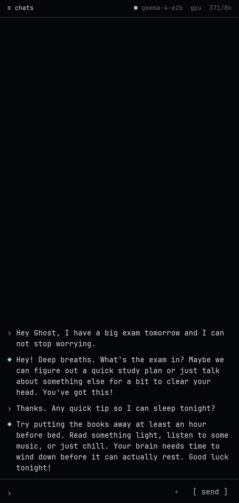
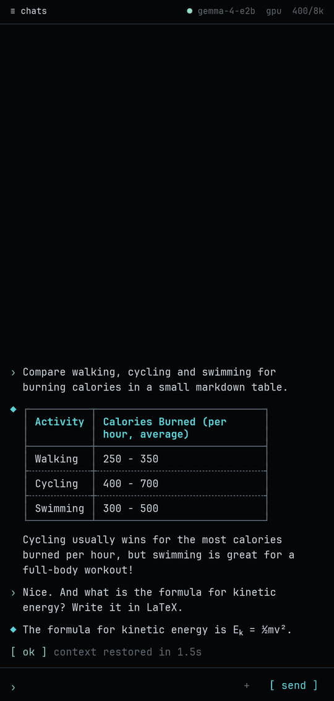
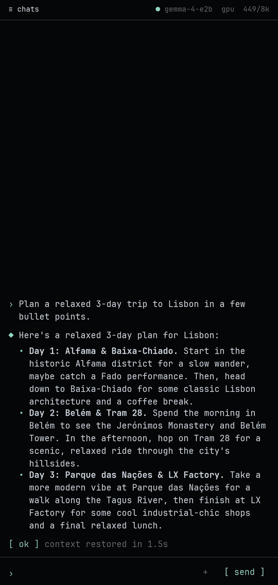
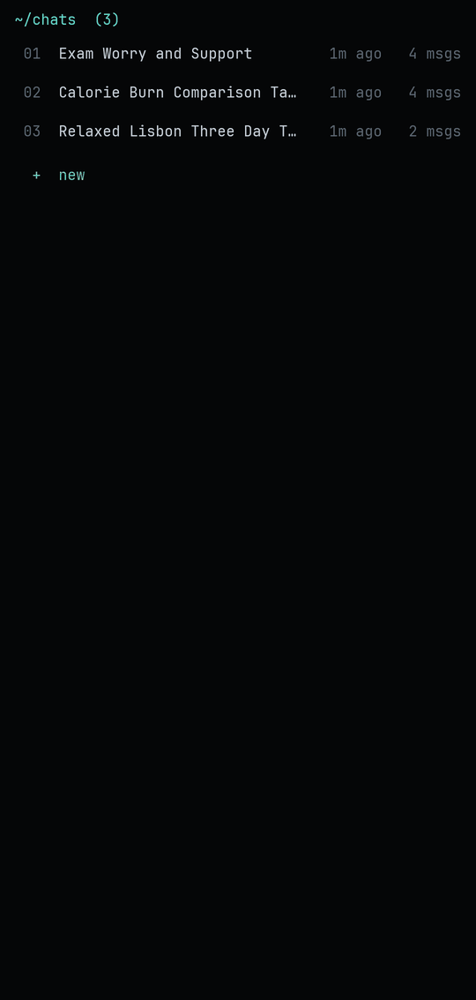

<h1 align="center">
  &nbsp;Ghost
</h1>

<p align="center">
  <b>A private AI chat that runs entirely on your phone.</b><br>
  No internet permission, no account, no server. Your conversations never leave the device.
</p>

<p align="center">
  <a href="https://github.com/naginagiyev/ghost/releases/latest"></a>
  <a href="https://github.com/naginagiyev/ghost/actions/workflows/ci.yml"></a>
  
  
  <a href="LICENSE"></a>
</p>

<p align="center">
  <a href="https://github.com/naginagiyev/ghost/releases/latest/download/ghost.apk"><b>⬇ Download the latest APK</b></a>
</p>

<p align="center">
  
  
  
  
</p>

## Features

- **Fully on-device.** Runs Google's Gemma 4 models with LiteRT-LM on the phone's GPU or CPU. The app has no internet permission at all.
- **Remembers your chats.** Conversations are saved locally. Long chats keep short notes of important facts instead of forgetting old messages.
- **Photos and documents.** Attach a photo from the gallery or camera, or a PDF, DOCX, Markdown or TXT file, and ask about it.
- **Several models.** Import any `.litertlm` model and switch between them in one tap.
- **Tunes itself.** Picks CPU or GPU, the context size and speculative decoding for each model from measurements on your phone.
- **Readable answers.** Markdown, code blocks, tables and LaTeX formulas are rendered in a dark terminal style.
- **Edit and retry.** Long-press your last message to edit it and get a new answer.

## Getting started

1. **Install the app.** Download [`ghost.apk`](https://github.com/naginagiyev/ghost/releases/latest/download/ghost.apk) on your phone and open it. Android asks once to allow installs from your browser or file manager.
2. **Get a model.** Download a Gemma 4 model in `.litertlm` format, for example [`gemma-4-E2B-it.litertlm`](https://huggingface.co/litert-community/gemma-4-E2B-it-litert-lm) (2.6 GB, recommended for phones with 8 GB of RAM) or the larger [`gemma-4-E4B-it.litertlm`](https://huggingface.co/litert-community/gemma-4-E4B-it-litert-lm).
3. **Import it.** In Ghost, tap the model name at the top right, then **+ import a .litertlm file** and pick the downloaded file. Ghost copies it into its private storage, so the downloaded copy can be deleted afterwards.

The first load compiles the model for your GPU and takes a little longer. After that, the model loads in a few seconds whenever you open the app and is unloaded 30 seconds after you leave it.

## Using Ghost

| Action | How |
|---|---|
| Send a message | Type and tap `[ send ]`. Enter adds a new line. |
| Attach a photo or file | Tap `+`, then `[ photo ]`, `[ camera ]` or `[ file ]`. |
| Stop an answer | Tap `[ stop ]`. |
| Copy an answer | Long-press it. |
| Edit your last message | Long-press it, change the text and send. |
| Open, pin, rename or delete chats | Tap `≡ chats` at the top left. Hold a chat for more options. |
| Switch, import or delete models | Tap the model name at the top right. Hold a model to delete it. |

The dot next to the model name shows its state: green ready, amber loading or busy, red failed, gray unloaded.

## Requirements

- Android 8.0 (API 26) or newer on a 64-bit ARM phone (`arm64-v8a`)
- 8 GB of RAM recommended for Gemma 4 E2B; more for larger models
- About 3 GB of free storage per model

## Building from source

You need JDK 17 or newer (Android Studio's bundled JBR works) and the Android SDK with platform 37.

```bash
git clone https://github.com/naginagiyev/ghost.git
cd ghost
./gradlew testDebugUnitTest assembleDebug
adb install -r app/build/outputs/apk/debug/app-debug.apk
```

`./gradlew assembleRelease` builds an optimized, R8-shrunk APK. It is signed with the release key when `keystore.properties` (or the `GHOST_KEYSTORE`, `GHOST_KEYSTORE_PASSWORD`, `GHOST_KEY_ALIAS` and `GHOST_KEY_PASSWORD` environment variables) is present, and with the debug key otherwise.

For development, a model can be copied straight into a debug build instead of importing it:

```bash
adb push gemma-4-E2B-it.litertlm /data/local/tmp/
adb shell run-as app.ghost mkdir -p files/models
adb shell run-as app.ghost cp /data/local/tmp/gemma-4-E2B-it.litertlm files/models/
```

Debug builds also accept a message from adb (`/new` starts a new chat):

```bash
adb shell am start -n app.ghost/.MainActivity --es prompt "why is the sky blue"
```

### Releases

Pushing a version tag builds, signs and publishes a release with GitHub Actions:

```bash
git tag v1.0.1
git push origin v1.0.1
```

Bump `versionCode` and `versionName` in `app/build.gradle.kts` before tagging. The workflow needs the repository secrets `GHOST_KEYSTORE_BASE64`, `GHOST_KEYSTORE_PASSWORD`, `GHOST_KEY_ALIAS` and `GHOST_KEY_PASSWORD`.

## How it works

The engine, the context restore, the self-tuning and the measured speeds are described in [docs/HOW-IT-WORKS.md](docs/HOW-IT-WORKS.md).

## Privacy

- No `INTERNET` permission: Android itself blocks every network connection.
- Models, chats, photos and documents are stored in the app's private storage and are removed when the app is uninstalled.
- Cloud backup and device-to-device transfer are turned off for all app data.
- No analytics, crash reporting or ads.

## Acknowledgements

- [Gemma 4](https://ai.google.dev/gemma) models by Google
- [LiteRT-LM](https://github.com/google-ai-edge/LiteRT-LM) on-device inference runtime
- [pdfbox-android](https://github.com/TomRoush/PdfBox-Android) for reading PDF files
- [JetBrains Mono](https://www.jetbrains.com/lp/mono/) font, licensed under the [SIL Open Font License](docs/licenses/JetBrainsMono-OFL.txt)

## License

Ghost is released under the [Apache License 2.0](LICENSE). Models you import are covered by their own licenses.
